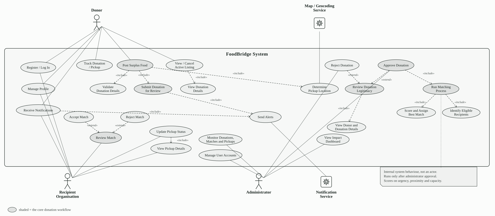
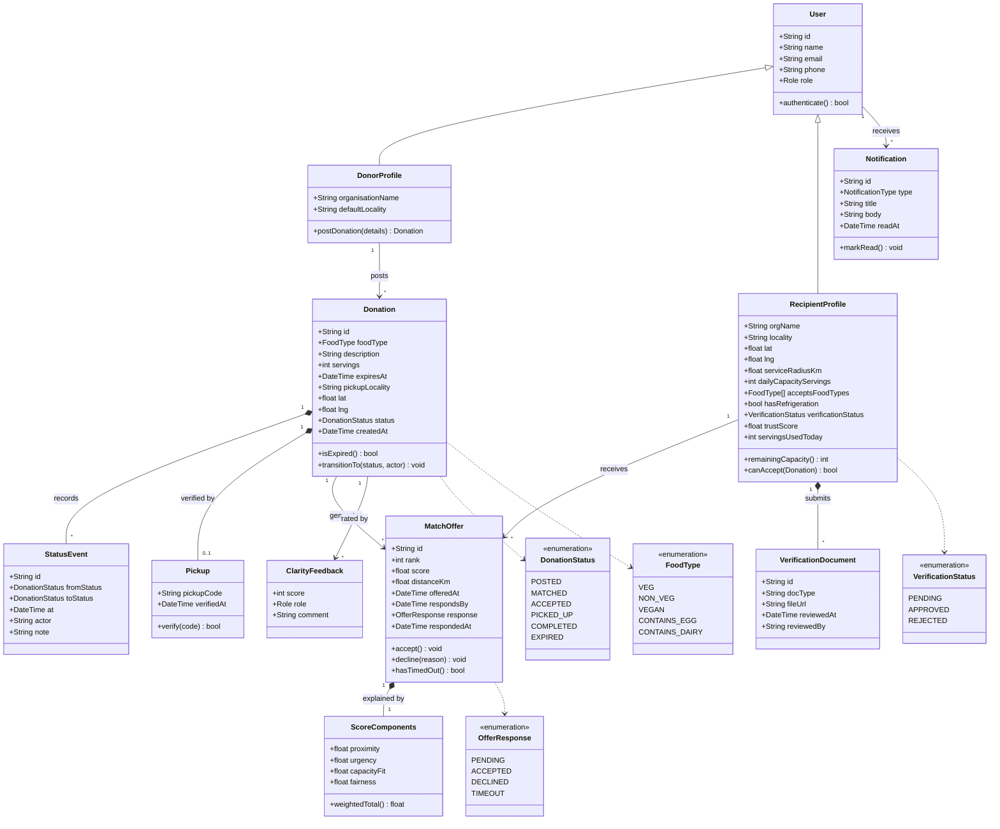
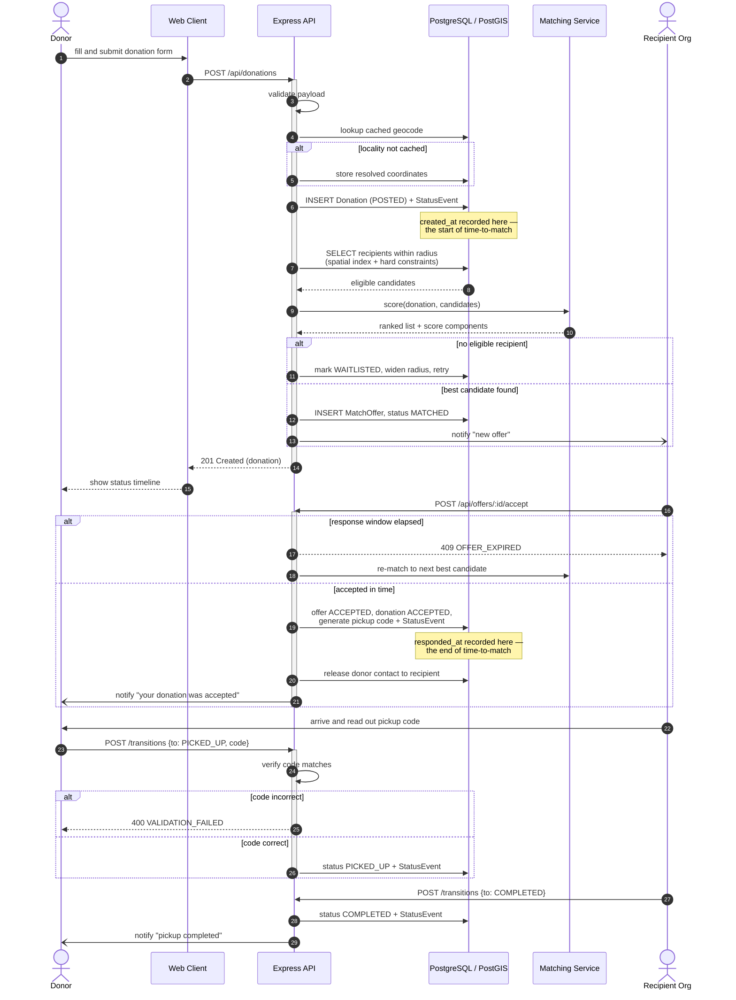
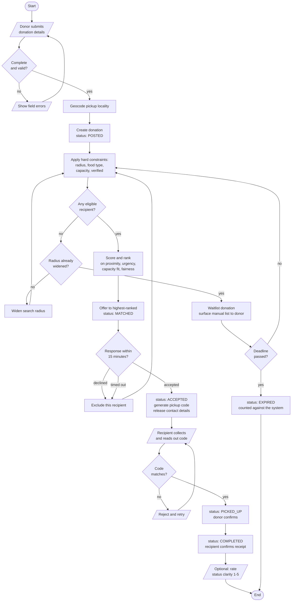
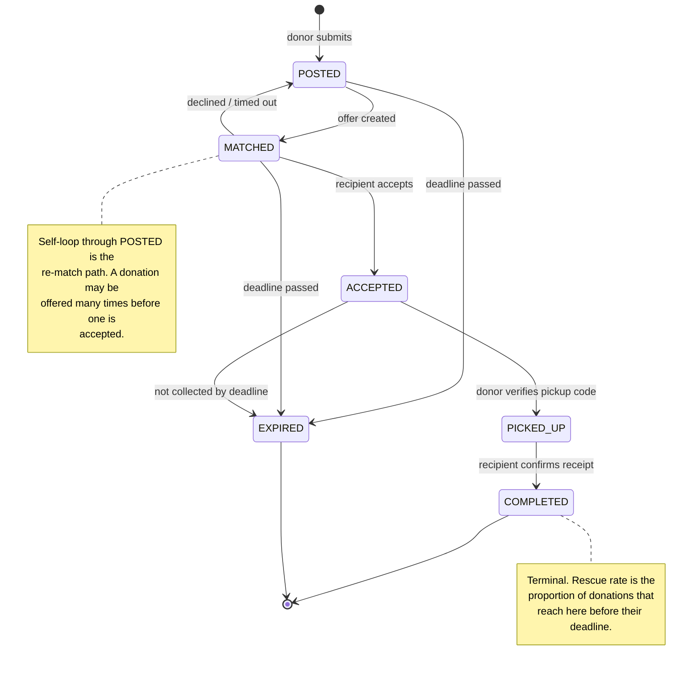

# FoodBridge — Use Case and UML Models

UCS503P Software Engineering · Team 3 · Thapar Institute

Models for the surplus food redistribution matcher described in the project
proposal. Each diagram is followed by the reasoning behind its relationships, so
the choices can be defended rather than only shown.

**Contents**

1. [Actors](#1-actors)
2. [Use Case Diagram](#2-use-case-diagram)
3. [Class Diagram](#3-class-diagram)
4. [Sequence Diagram](#4-sequence-diagram--donation-to-completed-pickup)
5. [Activity Diagram](#5-activity-diagram--donation-lifecycle)
6. [State Machine Diagram](#6-state-machine-diagram--donation-status)

---

## 1. Actors

| Actor | Kind | Goal in the system |
|---|---|---|
| **Donor** | Primary, human | Hand over surplus food before it spoils, with a record that it was collected |
| **Recipient Organisation** | Primary, human | Receive food it can actually use, within its capacity and service area |
| **Administrator** | Primary, human | Keep unverified organisations out, and see whether the system is working |
| **Matching Service** | Secondary, system | Rank eligible recipients for a donation (standalone Python component) |
| **Geocoding Service** | Secondary, external | Resolve a pickup locality to coordinates |

**Why Donor and Recipient Organisation are separate actors rather than one
"User".** They share authentication, but they share no goal: a donor's
interaction ends when the food is collected, a recipient's begins when an offer
arrives. Their use cases are disjoint apart from the two inherited from
`Registered User`, so modelling them as one actor would hide that the system has
two distinct sides.

**Why the Matching Service is an actor and not just an internal function.** The
proposal isolates allocation behind a service boundary so it can be replaced
without touching the application. Anything outside the system boundary that the
system exchanges messages with is an actor, and this component is deliberately
outside it.

---

## 2. Use Case Diagram

*Three human actors, two system actors, and the FoodBridge system boundary.
`Donor` and `Recipient Organisation` both specialise `Registered User`. Dashed
arrows are stereotyped dependencies: `«include»` for behaviour the base use case
always performs, `«extend»` for behaviour that occurs only under a condition.*

### Justifying the relationships

**`«include»` — always happens, and the base use case is incomplete without it.**

- `Post surplus donation` includes `Geocode pickup locality`: a listing with no
  coordinates cannot be matched at all, so geocoding is not optional behaviour.
- `Post surplus donation` includes `Match donation to recipient`: posting always
  triggers allocation. The donor never asks for it separately.
- `Match donation` includes `Filter eligible recipients` **and** `Score and rank
  recipients`: the proposal specifies hard constraints applied first as filters,
  then a weighted score over the survivors. Two steps, both mandatory, in order.
- `Confirm handover` includes `Verify pickup code`: the handover *is* the
  verification. Without it the transition means nothing.

**`«extend»` — conditional, and the base use case is complete without it.**

- `Re-match donation` extends `Respond to offer`: only when the response is a
  decline or a timeout. An accepted offer never re-matches.
- `Widen search radius` extends `Match donation`: only at the extension point
  where no recipient passes the hard constraints. This is the graduated fallback
  the proposal commits to.
- `Rate status clarity` extends `Track donation status`: offered only once a
  donation reaches `Completed`, and the user may decline to rate.

**Generalization.** `Donor` and `Recipient Organisation` both specialise a
`Registered User` who can `Log in` and `Receive notification`. Those two use
cases are drawn once and inherited, rather than duplicated per actor.

**A note on what is deliberately absent.** There is no `Arrange transport` use
case. The proposal states that pickup transport is arranged by the two matched
parties and that the system coordinates rather than dispatches — so it is outside
the system boundary and does not belong on this diagram.

---

## 3. Class Diagram

### Justifying the structure

**Why `MatchOffer` is a class and not an association.** A donation can be offered
to several organisations in sequence — declined by the first, re-offered to the
next. Each offer carries its own rank, score, timestamps and response, so the
association between `Donation` and `RecipientProfile` has attributes of its own.
That makes it an association class, modelled here as a full entity.

**Why `ScoreComponents` is composition (filled diamond).** The four component
values have no meaning and no identity apart from the offer that produced them;
delete the offer and they are meaningless. This is exactly the requirement in the
proposal that every offer stores its component values so an allocation can be
explained after the fact.

**Why `StatusEvent` is composition, not aggregation.** The event log belongs to
one donation for its lifetime and cannot be transferred to another. It is also
where the primary evaluation metric comes from: time-to-match is the interval
between the donation's `createdAt` and the `at` of its `ACCEPTED` event, so these
records are part of the donation, not a shared resource.

**Why `Pickup` is `0..1`.** A pickup code exists only once an organisation has
accepted. A donation that expires unmatched never has one.

**Why `DonorProfile` and `RecipientProfile` specialise `User`.** Both need
authentication and contact details, but a recipient carries eight attributes a
donor has no use for — service radius, capacity, dietary constraints,
verification state. Putting them on one class would leave most fields null for
half the rows.

---

## 4. Sequence Diagram — donation to completed pickup

### Justifying the interaction

**Why the handover takes two messages from two different actors.** The donor
writes `PICKED_UP` and only the recipient can write `COMPLETED`. If either party
could perform both, the pickup code would prove nothing and the two timestamps
would stop being independent evidence that the food changed hands. This is
enforced on the server; hiding a button in the interface is not sufficient.

**Why geocoding is a lookup before a call.** The proposal commits to caching
geocoding results so repeated addresses cost no external calls, which also keeps
the system inside a free tier during the pilot.

**Why the metric boundaries are marked.** Time-to-match is measured from the
donation's `created_at` to the `responded_at` of the first accepted offer. Both
are written by the system, never entered by a user, so the primary metric cannot
be influenced by self-report.

**Why `alt` fragments rather than a separate diagram per path.** Decline, timeout
and an incorrect code are normal paths in this workflow, not error handling.
Modelling them inline keeps them visible as expected behaviour.

---

## 5. Activity Diagram — donation lifecycle

### Justifying the flow

**Why the decline path loops back to the constraint filter rather than to
ranking.** A declining organisation must be excluded from the candidate set, so
re-matching re-evaluates eligibility rather than simply taking the next row of a
stale ranking. Capacity may also have changed in the interval.

**Why widening the radius is guarded.** Without the "already widened?" decision
the fallback would loop forever on a donation nobody can take. The proposal
specifies a graduated fallback — widen, then waitlist, then surface a manual list
— and the guard is what makes it graduated rather than infinite.

**Why expiry is a decision node reachable from several states, not a terminal
step.** A donation can expire while posted, while offered, or after acceptance if
nobody collects it. Every path that waits is subject to the deadline.

---

## 6. State Machine Diagram — donation status

### Justifying the states

**Why `MATCHED → POSTED` rather than a direct `MATCHED → MATCHED` self-loop.**
Returning to `POSTED` states the truth: the donation is unallocated again and
back in the pool. A self-loop would suggest it still holds a live offer.

**Why `EXPIRED` is reachable from three states and not only from `POSTED`.** The
deadline is absolute. An organisation can accept a donation and then fail to
collect it, and the system must count that against itself rather than quietly
mark it successful.

**Why there is no `CANCELLED` state on this diagram.** Donor cancellation exists
as a use case but the proposal's first iteration measures rescue rate against
posted donations. Adding cancellation would let a donor remove a donation from
the denominator after the fact, which would make the primary metric gameable.
Modelling it is deferred until that accounting is decided.

---

## Traceability

Every use case here maps to a documented endpoint in
[`../code/API_CONTRACT.md`](../code/API_CONTRACT.md), and the status transitions
in sections 4–6 are the same table that document specifies and the frontend
implements. The models and the running code are intended to stay in agreement; if
one changes, the other is wrong.
